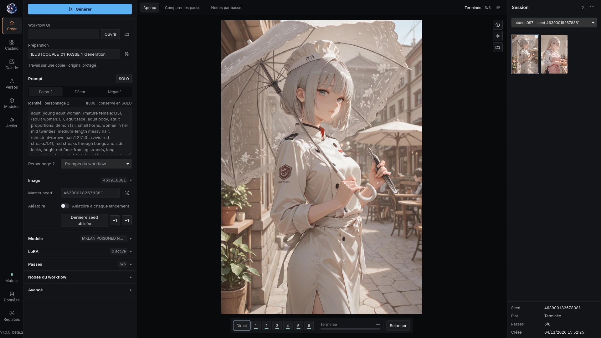
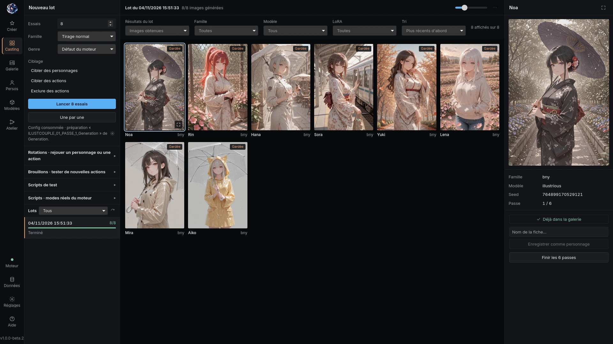
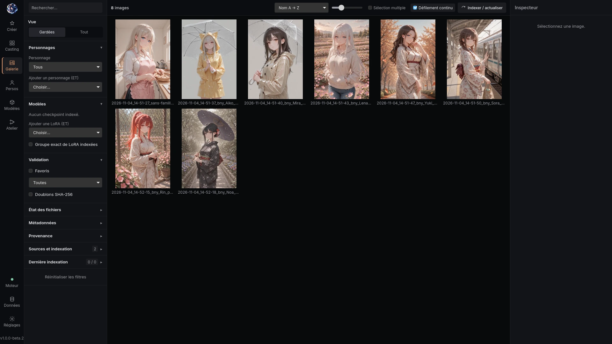

# Saya Studio



| Casting | Gallery |
|:---:|:---:|
|  |  |

**1.1.0 — stable.** A local desktop app (Tauri 2, Rust, Svelte 5, SQLite) that drives
[ComfyUI](https://github.com/comfyanonymous/ComfyUI) for anime-style character images. Nothing runs in the
cloud: Saya Studio is the interface, ComfyUI is the render engine.

It is the companion app of the **Saya Couple** node pack in this repository, and like the pack it is first a
backup of my own setup, published in case it helps someone. Back up your data, and use it at your own risk.

## New in 1.1.0

Duo casting (experimental), invented characters named in a style that suits them, and one clearly named file per
render, dated on your local day.

See the [complete 1.1.0 changes and validation](RELEASE_NOTES.md#whats-new-in-110).

## What it does

- **Generation**: open a ComfyUI workflow (UI format), check its faithful API conversion, edit inputs, submit,
  follow progress. The bundled **Saya preset** chains six passes (composition, hires fix, HiDream, post,
  detailers, final upscale) with memory released between passes.
- **Crash resume**: if ComfyUI or the app stops in the middle of a run, the run is kept on disk with its seed.
  **Reprendre depuis la passe N** (in Generation, and on each Casting trial) continues from the last finished
  pass; a pass already sent to ComfyUI is never sent twice.
- **Casting**: asks a draw engine for N characters, renders pass 1 only, lets you keep some and send them
  through the six passes. The six passes of kept images wait until every pass-1 trial of the batch is done, so
  two heavy models never share the GPU. **Images manquantes** gives a picture to the characters that have none
  (random pose, then Yes = six passes and saved, No = another pose). *The draw engine itself is not
  distributed*; without one, Casting stays unavailable and says so.
- **Drafts and pending actions**: a new action is tested in an isolated copy of the engine before it is added
  for real; actions the engine does not draw yet are listed with the reason, and you **Validate** or
  **Refuse** each one yourself. Nothing is validated automatically.
- **Gallery**: indexes your image folders (incremental, SHA-256, ComfyUI PNG metadata), filters by checkpoint,
  LoRA and character, favourites, review, duplicates; files deliveries by day and family. Casting images show
  the character's name. **Envoyer au workflow complet** reopens an image in Generation with its own workflow.
- **Characters**: sheets (identity prompt + anatomy), variants with backgrounds, reference images, import.
- **Models**: LoRA manager (send to the generation, stack), checkpoints.
- **Right-click menus** on gallery images, casting batches and trials, and models.
- **Workshop**: graph editor (native ComfyUI graphs, subgraphs), workflows, pipelines, A/B lab, scenes.
- **Node check**: lists the nodes a workflow needs and the ones missing from your ComfyUI, in the app or from a
  script: `saya-studio-maintenance check-workflow FILE_OR_FOLDER object_info.json` (exit 0 complete, 2 missing).
- **Developer mode** (Settings): action console, preference editor, data folders, node check.
- **Updates**: at startup the app checks GitHub for a newer release and offers to install it (see below).
- Fast on large libraries: pages open in tens of milliseconds and keep their state when you come back.
- 14 interface languages (French by default).

## Requirements

- Linux x86_64 with WebKitGTK 4.1 (Debian 12+, Ubuntu 22.04+, Fedora 39+, openSUSE Tumbleweed / Leap 15.6,
  Arch / EndeavourOS, NixOS).
- Windows 10/11 x64 with WebView2, or macOS 11+ (Apple Silicon or Intel).
- A running ComfyUI (default `~/AI/ComfyUI`, listening on `127.0.0.1:8188`) with the **Saya Couple** nodes
  2.3.0 or newer from this repository, and the models your workflow needs.
- Python 3 (sidecars). Optional: `ffmpeg` for LoRA video previews.

## Install

Packages are attached to the GitHub release
[`studio-v1.1.0`](https://github.com/alphaziod/saya-studio-x-couple/releases/tag/studio-v1.1.0).

**Linux, the simple way:** download `install.sh` from the release and run `sh install.sh`. It detects your
distribution, downloads the matching package, checks it against `SHA256SUMS` and asks before installing. It can
also install the Saya Couple nodes (choice 1, 2 or 3).

| Distribution | File / command |
|---|---|
| Windows 10/11 x64 | `saya-studio-1.1.0-windows-x64.exe` |
| macOS Apple Silicon | `saya-studio-1.1.0-macos-arm64.dmg` |
| macOS Intel | `saya-studio-1.1.0-macos-x64.dmg` |
| Debian, Ubuntu | `sudo apt install ./saya-studio_1.1.0_amd64.deb` |
| Fedora | `sudo dnf install ./saya-studio-1.1.0.fedora.x86_64.rpm` |
| openSUSE | `sudo zypper install ./saya-studio-1.1.0.opensuse.x86_64.rpm` |
| Arch, EndeavourOS | `sudo pacman -U ./saya-studio-1.1.0-x86_64.pkg.tar.zst`, or AUR `saya-studio-bin` |
| NixOS / Nix | `nix run github:alphaziod/saya-studio-x-couple?dir=studio` |
| Any distribution | `saya-studio_1.1.0_amd64.AppImage` (`chmod +x`, then run it), or `flatpak install --user ./saya-studio-1.1.0-x86_64.flatpak` |

Check a download by hand: `sha256sum -c SHA256SUMS --ignore-missing`.

**First launch on Windows and macOS.** The builds are not signed by Microsoft or notarized by Apple, so the
system may block them once. Windows: *More info → Run anyway*. macOS: right-click the app in Applications →
*Open* → *Open* (or `xattr -dr com.apple.quarantine "/Applications/Saya Studio.app"`).

Release notes: [RELEASE_NOTES.md](RELEASE_NOTES.md). Build steps and per-distribution dependencies: [docs/PACKAGING.md](docs/PACKAGING.md).
French install guide for Arch: [docs/INSTALLATION-ARCH.md](docs/INSTALLATION-ARCH.md).

## Updating

- **From the app:** at startup Saya Studio asks GitHub for the latest release. If there is a newer one, a banner
  offers to install it: the app downloads the package for your system and checks it against `SHA256SUMS`. A
  Linux package is then installed after your system asks for your password; on Windows and macOS the app opens
  the installer or the disk image; an AppImage is saved and the command to run is shown. Turn the check off
  in Settings (*Vérifier les mises à jour au démarrage*).
- **From a terminal (Linux):** `sh install.sh --update` (or choice 4 in its menu); `--dry-run` only shows what
  it would do.
- A build you compiled yourself is recognised as a local build: the app tells you a release exists but never
  replaces it without asking.
- Updating keeps your database, images, characters and settings. Back them up first anyway (see below).

## Build from source

```sh
cd studio
npm ci
npm run tauri -- dev                                   # development window
npm run build && cargo build -p saya-studio --features custom-protocol
./target/debug/saya-studio
```

Tests: `cargo test -p studio-core`, `node --test scripts/*.test.mjs`, `npx svelte-check`
([docs/TESTING.md](docs/TESTING.md)). Check workflow files against a ComfyUI node list:
`bash scripts/check-workflows.sh WORKFLOW_DIR OBJECT_INFO.json`.

## Your data

- App data: `~/.local/share/studio.saya.desktop/` on Linux, `%APPDATA%/studio.saya.desktop/` on Windows, `~/Library/Application Support/studio.saya.desktop/` on macOS (SQLite database, thumbnails, run manifests).
- Lasting settings and your own presets: `~/Documents/saya studio config/` (copy it to move your setup).
- Delivered images: `~/Images/saya studio/` (changeable in Settings).
- Backups: `saya-studio-maintenance backup|verify|restore` ([docs/SAUVEGARDES.md](docs/SAUVEGARDES.md)).

The app never deletes your originals; temporary previews are cleaned by rule.

The gallery uses each system's recoverable trash (Linux, Windows Recycle Bin, macOS Trash).
On Windows and macOS, launching Studio registers its native host for Chrome, Chromium, Brave and Edge.
The extension connects to the running app without manually copying its token.

## Known limitations

- Tested day to day on Arch (Wayland/Niri) with an AMD GPU. Windows and macOS packages have CI installation/startup checks, not a full manual UI or GPU validation.
- Windows packages are unsigned; macOS packages use ad-hoc signing and are not Apple-notarized. OS security checks can block the first launch.
- Legacy `.bash` engine launchers require Bash; Python test scripts use `python` on Windows and `python3` elsewhere (`SAYA_PYTHON` overrides this).
- AppImage: presets and helpers are found next to the binary (`../share/saya-studio`); not run by hand yet.
- Flatpak runs sandboxed: access to ComfyUI and your folders goes through the permissions listed in
  its manifest; the browser extension bridge may not work there.
- The bundled preset ships with neutral SFW example prompts and empty LoRA stacks: fill in your own.

## For AI agents and contributors

Start with [AGENTS.md](AGENTS.md): build from an empty machine, repository map, rules that protect the user's
data, how-tos (workflow conversion, pipelines, casting, characters, backgrounds), a first-contact questionnaire,
and optional prompt skills in `agent-skills/`.

## License

GPL-3.0-or-later, like the rest of this repository (see `../LICENSE`).
